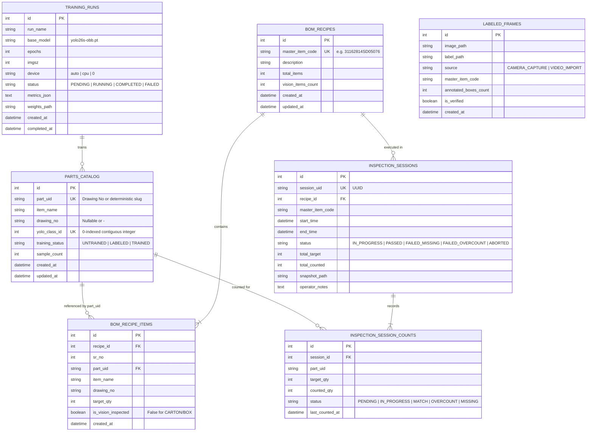
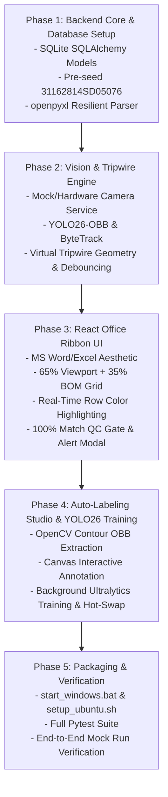

# IMPLEMENTATION PLAN: Industrial Conveyor Belt BOM Vision Inspector

**System Version**: 2.6.0-OBB  
**Author**: Principal Industrial Computer Vision & Full-Stack Engineer  
**Target Environments**: Windows 11 (Development / Testing / CPU-CUDA) & Ubuntu 22.04/24.04 LTS (Production Deployment)  
**Primary Models**: Ultralytics YOLO26-OBB (`yolo26n-obb.pt`, `yolo26s-obb.pt`, `yolo26m-obb.pt` with native `nms=False` end-to-end inference)

---

## 1. Executive Summary & System Architecture

### 1.1 Problem Statement
In manufacturing packaging lines for knock-down furniture and industrial assemblies (such as the Khalapur plant), hardware kits (`HRD PKT`) contain dozens of fasteners, plugs, dowels, and brackets. Manual verification is error-prone, leading to missing parts in shipped customer boxes. 

### 1.2 Solution Architecture
The **Industrial Conveyor Belt BOM Vision Inspector** is a self-contained, offline-capable edge inspection station. The system:
1. Imports manufacturing plant Excel BOM spreadsheets (.xlsx / .xls), parses merged headers, extracts line items, applies canonical `part_uid` slugging for non-drawing items, and automatically excludes packaging components.
2. Maps all line items to a persistent SQLite **Global Part Master Catalog**, maintaining contiguous YOLO class IDs and tracking training statuses (`UNTRAINED`, `LABELED`, `TRAINED`).
3. Operates a real-time conveyor vision engine using YOLO26 Oriented Bounding Boxes (OBB) with native end-to-end inference (`nms=False`) coupled with ByteTrack object tracking.
4. Uses a configurable **Virtual Tripwire** crossing detector that increments item counts as hardware parts pass on the belt.
5. Displays an **Industrial Office Ribbon** desktop UI (Microsoft Word / Excel aesthetic) showing a live conveyor viewport and a real-time color-coded Excel recipe grid.
6. Enforces a strict **100% Match QC Gate**: Blocking label printing if any vision-inspected item is missing or over-counted, with instant audit snapshot logging.
7. Features an embedded **Auto-Labeling Studio** (OpenCV adaptive contour OBB detection + interactive HTML5 Canvas editor) and a **Background YOLO26 Training Pipeline** with live model hot-swapping.

```
+----------------------------------------------------------------------------------------------------+
|                                    INDUSTRIAL CONVEYOR WORKSTATION                                 |
+----------------------------------------------------------------------------------------------------+
|                                                                                                    |
|  [ Industrial Camera / USB / RTSP ]  --->  [ Video Source Layer (Mock / Hardware) ]                 |
|                                                              |                                     |
|                                                              v                                     |
|  [ Barcode / QR Scanner (Recipe Trigger) ]                 [ OpenCV Frame Preprocessor ]           |
|                                                              |                                     |
|                                                              v                                     |
|                                                [ YOLO26-OBB Engine (nms=False) ]                   |
|                                                              |                                     |
|                                                              v                                     |
|                                                [ ByteTrack Multi-Object Tracker ]                  |
|                                                              |                                     |
|                                                              v                                     |
|                                                [ Virtual Tripwire Collision Logic ]                |
|                                                              |                                     |
|                       +--------------------------------------+---------------------+               |
|                       |                                                            |               |
|                       v                                                            v               |
|         [ Active Session BOM Counter ]                             [ MJPEG / WebSocket Broadcaster ]
|                       |                                                            |               |
|                       v                                                            v               |
|         [ 100% Match QC Gate Logic ]                         +-----------------------------------+ |
|                       |                                      | React "Office Ribbon" Desktop UI  | |
|         +-------------+-------------+                        | - Word-style Ribbon Navigation    | |
|         |                           |                        | - 65% Live Viewport + Tripwire    | |
|         v                           v                        | - 35% Excel Dense BOM Grid        | |
|     [ PASS ]                    [ BLOCK ]                    | - Live Status & Audit Logging     | |
|  - Green Banner             - Red Alert Modal                +-----------------------------------+ |
|  - Print QC Label           - Missing Items List                                                   |
|  - Log Snapshot             - Inhibit Conveyor/PLC                                                 |
|                                                                                                    |
+----------------------------------------------------------------------------------------------------+
```

---

## 2. Technology Stack & Directory Structure

### 2.1 Backend Stack
- **Runtime**: Python 3.11+
- **Web Framework**: FastAPI (high-throughput async endpoints, background tasks, WebSockets)
- **ASGI Server**: Uvicorn with lifespan management
- **Computer Vision**: OpenCV (`opencv-python-headless`) for frame capture, homography, tripwire geometry, and adaptive contour segmentation
- **Inference Engine**: Ultralytics YOLO26 (`ultralytics`) for Oriented Bounding Box (OBB) inference (`nms=False`)
- **Tracking**: ByteTrack / SORT tracking algorithm
- **Spreadsheet Engine**: `openpyxl` & `pandas` (multi-sheet scanning, merged-cell resolution, cell value normalization)
- **Database & ORM**: SQLite (`aiosqlite` & `SQLAlchemy`) for zero-configuration, cross-platform persistence
- **Validation**: Pydantic v2

### 2.2 Frontend Stack
- **Framework**: React 18 / 19 + TypeScript + Vite
- **Styling**: Tailwind CSS + custom utilitarian styles modeled after Microsoft Office Ribbon (Word / Excel 2016-2021 aesthetic)
- **Icons**: Lucide React (clean, industrial icons)
- **Canvas Rendering**: Native HTML5 2D Canvas for high-FPS live video overlays, oriented bounding boxes, and interactive polygon labeling
- **State Management**: Zustand / React Context with resilient WebSocket reconnection

### 2.3 Proposed Directory Structure
```
khalapur-kd-bom-vision/
├── backend/
│   ├── app/
│   │   ├── __init__.py
│   │   ├── main.py                     # FastAPI entrypoint & lifespan setup
│   │   ├── config.py                   # App configuration & cross-platform pathlib paths
│   │   ├── database.py                 # SQLite SQLAlchemy engine, session maker, base models
│   │   ├── models/
│   │   │   ├── __init__.py
│   │   │   ├── parts.py                # PartsCatalog ORM model
│   │   │   ├── recipe.py               # BomRecipe, BomRecipeItem ORM models
│   │   │   ├── session.py              # InspectionSession, InspectionSessionCount ORM models
│   │   │   ├── dataset.py              # LabeledFrame ORM model
│   │   │   └── training.py             # TrainingRun ORM model
│   │   ├── schemas/
│   │   │   ├── __init__.py
│   │   │   ├── parts.py                # Pydantic schemas for parts catalog
│   │   │   ├── recipe.py               # Pydantic schemas for BOM recipe & import
│   │   │   ├── session.py              # Pydantic schemas for inspection session & verification
│   │   │   └── training.py             # Pydantic schemas for training jobs
│   │   ├── services/
│   │   │   ├── __init__.py
│   │   │   ├── excel_parser.py         # Dedicated plant BOM Excel parser (openpyxl)
│   │   │   ├── camera_service.py       # Camera abstraction (Hardware / Mock video / Directory)
│   │   │   ├── vision_engine.py        # YOLO26-OBB inference + ByteTrack tracking
│   │   │   ├── tripwire_service.py     # Virtual tripwire geometry & crossing state machine
│   │   │   ├── auto_labeler.py         # OpenCV adaptive contour OBB auto-annotation
│   │   │   ├── training_service.py     # Background Ultralytics training runner & data.yaml generator
│   │   │   └── seed_data.py            # Pre-seeding default 31162814SD05076 recipe & parts
│   │   └── routes/
│   │       ├── __init__.py
│   │       ├── bom_routes.py           # Upload, preview, commit, list recipes
│   │       ├── parts_routes.py         # Global parts catalog & training status
│   │       ├── inspection_routes.py    # Session lifecycle, tripwire config, QC verification
│   │       ├── stream_routes.py        # MJPEG video feed & WebSocket real-time events
│   │       ├── labeling_routes.py      # Image capture, auto-contour, manual label saving
│   │       ├── training_routes.py      # Training initiation, metrics stream, model hot-swap
│   │       └── audit_routes.py         # Audit logs, batch stats, snapshot image serving
│   ├── tests/
│   │   ├── __init__.py
│   │   ├── test_excel_parser.py        # Tests for merged headers, slugging, CARTON exclusion
│   │   ├── test_tripwire.py            # Tests for 2D line crossing vectors & debouncing
│   │   ├── test_parts_catalog.py       # Tests for upsert logic & contiguous class IDs
│   │   └── test_dataset_export.py      # Tests for YOLO-OBB data.yaml & label formatting
│   ├── datasets/
│   │   └── bom_dataset/                # Directory for images and YOLO-OBB label .txt files
│   ├── models/
│   │   └── weights/                    # Saved YOLO26 weights (.pt files)
│   ├── static_audit/                   # Saved batch QC snapshot images
│   ├── sample_data/                    # Sample Excel sheets and mock conveyor video clips
│   └── requirements.txt
├── frontend/
│   ├── src/
│   │   ├── assets/
│   │   ├── components/
│   │   │   ├── layout/
│   │   │   │   ├── TitleBar.tsx        # Top Windows/Office title bar with hardware status pills
│   │   │   │   ├── RibbonToolbar.tsx   # Word-style tabs & categorized action button groups
│   │   │   │   └── StatusBar.tsx       # Bottom MS Word blue status bar (FPS, model, counts)
│   │   │   ├── inspection/
│   │   │   │   ├── ConveyorViewport.tsx# 65% canvas viewport with tripwire & OBB bounding boxes
│   │   │   │   ├── BomGrid.tsx         # 35% Excel dense recipe table with status highlights
│   │   │   │   ├── QcStatusBanner.tsx  # Large high-contrast PASS / MISSING banner
│   │   │   │   └── QcAlertModal.tsx    # Red blocking dialog listing missing drawing numbers
│   │   │   ├── bom/
│   │   │   │   ├── ExcelUploadModal.tsx# File dropzone & multi-sheet selector
│   │   │   │   ├── BomPreviewTable.tsx # Parsed preview showing auto-excluded packaging items
│   │   │   │   └── PartsCatalogTable.tsx# Global part master list with training status pills
│   │   │   ├── labeling/
│   │   │   │   ├── LabelingStudio.tsx  # Main labeling view with filter by untrained parts
│   │   │   │   ├── CanvasAnnotation.tsx# Interactive HTML5 Canvas for OBB dragging & rotating
│   │   │   │   └── ContourSliders.tsx  # OpenCV adaptive threshold & min-area controls
│   │   │   ├── training/
│   │   │   │   ├── TrainingDashboard.tsx# Model selection, epochs, device selector
│   │   │   │   ├── MetricsChart.tsx    # Live loss / mAP progress curves
│   │   │   │   └── ModelManager.tsx    # Model list with "Activate Model" hot-swap button
│   │   │   └── audit/
│   │   │       └── AuditLogViewer.tsx  # Table of historical batches with snapshot viewer
│   │   ├── hooks/
│   │   │   ├── useInspectionStream.ts  # WebSocket hook for live count events & frames
│   │   │   └── useTripwireConfig.ts    # Hook for tripwire positioning & line dragging
│   │   ├── types/
│   │   │   ├── bom.ts
│   │   │   ├── inspection.ts
│   │   │   └── labeling.ts
│   │   ├── services/
│   │   │   └── api.ts                  # Axios/Fetch client
│   │   ├── App.tsx                     # Main layout coordinator
│   │   ├── main.tsx
│   │   └── index.css                   # Custom Office Ribbon theme & Tailwind directives
│   ├── index.html
│   ├── package.json
│   ├── tsconfig.json
│   ├── vite.config.ts
│   └── tailwind.config.js
├── deployment/
│   ├── start_windows.bat               # One-click Windows 11 development launcher
│   ├── setup_ubuntu.sh                 # Production provisioning script for Ubuntu 22.04/24.04
│   └── bom-inspector.service           # Systemd service unit definition
├── GEMINI.md                           # Strict project architectural & UI design rules
└── IMPLEMENTATION_PLAN.md              # This document
```

---

## 3. Database Architecture & Schema Specification

The application uses SQLite via SQLAlchemy with `aiosqlite` for asynchronous I/O. File paths are managed strictly through `pathlib.Path` to guarantee seamless cross-platform parity between Windows 11 and Ubuntu Linux.



### 3.1 DDL Schema (SQLAlchemy Models)
1. **`parts_catalog`**:
   - `id`: `Integer`, Primary Key, Autoincrement.
   - `part_uid`: `String(128)`, Unique, Indexed, Not Null. The definitive canonical key.
   - `item_name`: `String(255)`, Not Null.
   - `drawing_no`: `String(64)`, Nullable.
   - `yolo_class_id`: `Integer`, Unique, Indexed, Not Null. Guaranteed contiguous range `0 .. N-1` for direct YOLO `data.yaml` mapping.
   - `training_status`: `Enum('UNTRAINED', 'LABELED', 'TRAINED')`, Default `'UNTRAINED'`.
   - `sample_count`: `Integer`, Default `0`.

2. **`bom_recipes`**:
   - `id`: `Integer`, Primary Key, Autoincrement.
   - `master_item_code`: `String(64)`, Unique, Indexed, Not Null (e.g. `31162814SD05076`).
   - `description`: `String(255)`, Not Null.
   - `total_items`: `Integer`, Not Null.
   - `vision_items_count`: `Integer`, Not Null.

3. **`bom_recipe_items`**:
   - `id`: `Integer`, Primary Key, Autoincrement.
   - `recipe_id`: `Integer`, Foreign Key referencing `bom_recipes.id` on delete CASCADE.
   - `sr_no`: `Integer`, Not Null.
   - `part_uid`: `String(128)`, Foreign Key referencing `parts_catalog.part_uid`.
   - `item_name`: `String(255)`, Not Null.
   - `drawing_no`: `String(64)`, Nullable.
   - `target_qty`: `Integer`, Not Null.
   - `is_vision_inspected`: `Boolean`, Default `True`.

4. **`inspection_sessions` & `inspection_session_counts`**:
   - Stores every verification batch with exact timestamp, target vs. counted numbers, operator ID/notes, snapshot image path, and strict PASS/FAIL state.

---

## 4. Exact Excel BOM Parser Specification & Edge Cases

The plant Excel BOM layout has historical formatting nuances that require resilient parsing logic.

### 4.1 Header & Metadata Extraction Rules
1. **Multi-Sheet Handling**: By default, the parser inspects all sheets. If a sheet contains the token `BOM` or `Item Code`, it is prioritized; otherwise, the first non-empty sheet is loaded.
2. **Metadata Scan (Top Rows 1 to 10)**:
   - Scans rows for cells containing `Item Code(Master)` or `Item Code (Master)` or `Master Code`.
   - Resolves merged cells: In Excel, merged cells store their value in the top-left cell; adjacent cells evaluate to `None`. The parser detects `cell.coordinate` within `sheet.merged_cells.ranges` and reads the master cell value.
   - Scans for `Description` or `Master Description` and extracts the corresponding product string (e.g., `HRD PKT FOR MAIN BODY 900W/1200W 560D KREATION`).

### 4.2 Table Header Detection
The parser scans rows downward until it finds a row matching at least 3 of the following 4 column tokens:
- Column 1: `Sr No`, `Sr. No`, `S.No`, `SL No`, `Item No`
- Column 2: `Item Name`, `Description`, `Part Name`, `Material Description`
- Column 3: `Drawing No`, `Drg No`, `Drawing Number`, `Drg. No.`
- Column 4: `Qty`, `Quantity`, `Target Qty`, `BOM Qty`, `Req Qty`

Once the header row index $R_{head}$ is found, the parser maps column indices dynamically:
$$C_{sr}, C_{name}, C_{dwg}, C_{qty}$$

### 4.3 Canonical `part_uid` Slugging Rule
In manufacturing BOMs, many standard fasteners, sleeves, or packaging items lack formal CAD drawing numbers (entered as `—`, `-`, `NA`, or left blank). 
To ensure deterministic, persistent indexing:
1. Normalize `Drawing No`: Strip whitespace.
2. Check invalid values:
   $$\text{is\_empty} \iff \text{dwg} \in [\text{""}, \text{None}, \text{"—"}, \text{"–"}, \text{"-"}, \text{"NA"}, \text{"N/A"}, \text{"NONE"}, \text{"BLANK"}]$$
3. If valid:
   $$\text{part\_uid} = \text{Drawing No.upper()}$$
   *(Example: `HOM196273`)*
4. If invalid:
   Generate deterministic slug from `Item Name`:
   - Replace non-alphanumeric characters with `_`
   - Collapse consecutive underscores into a single `_`
   - Prefix with `NO_DWG_`
   *(Example: `M4 SLEEVE CONNECTING SCREW MAKE EBCO - CNS35-S` $\to$ `NO_DWG_M4_SLEEVE_CONNECTING_SCREW_MAKE_EBCO_CNS35_S`)*

### 4.4 Packaging Auto-Exclusion Rule
Plant hardware kits are packed into outer cartons or polybags. The camera inspects items entering the box, but the outer carton itself or polybags cannot be counted by the conveyor tripwire.
- Match keywords in uppercase `Item Name`:
  `PACKAGING_KEYWORDS = ["CARTON", "CORRUGATED BOX", "MASTER BAG", "POLYBAG", "PACKING BOX", "CORRUGATED SHEET", "BUBBLE WRAP", "BOX (", "CARTON ("]`
- If any keyword is found:
  `is_vision_inspected = False`
- In the UI, these rows are rendered with a distinctive light gray background, strikethrough/dimmed font, an Eye-Off icon, and an explicit checkbox allowing the supervisor to override if needed.

### 4.5 Pre-Seeded Default BOM: `31162814SD05076`
The system comes pre-seeded with the exact plant hardware kit:
- **Master Item Code**: `31162814SD05076`
- **Description**: `HRD PKT FOR MAIN BODY 900W/1200W 560D KREATION`

| Sr No | Item Name | Drawing No | Canonical `part_uid` | Target Qty | Vision Inspected |
|---|---|---|---|---|---|
| 1 | WOOD SCREW CSK PHILLIPS HEAD 3.5X15 C1018 ST YP | HOM196273 | `HOM196273` | 8 | Yes |
| 2 | WOOD SCREW PAN PHILLIPS HEAD 3.5X15 C1018 ST YP | HOM196276 | `HOM196276` | 10 | Yes |
| 3 | WOOD SCREW PAN PHILLIPS HEAD 3.5X20 C1018 ST YP | HOM196277 | `HOM196277` | 2 | Yes |
| 4 | WOOD SCREW PAN PHILLIPS HEAD 4.0X35 C1018 ST YP | HOM196280 | `HOM196280` | 4 | Yes |
| 5 | WOOD SCREW CSK PHILLIPS HEAD 4.0X45 C1018 ST YP | HOM196281 | `HOM196281` | 4 | Yes |
| 6 | DUST PLUG D8 BEIGE PA6 | HOM196328 | `HOM196328` | 4 | Yes |
| 7 | DUST PLUG D5 WHITE PA6 | HOM196329 | `HOM196329` | 4 | Yes |
| 8 | DUST PLUG D10 WHITE PA6 | HOM196330 | `HOM196330` | 4 | Yes |
| 9 | DUST PLUG D10 BEIGE PA6 | HOM196331 | `HOM196331` | 4 | Yes |
| 10 | HINGE EXPANSION DOWEL WITH M4 SCREW - CNS11 | HRD104875 | `HRD104875` | 4 | Yes |
| 11 | SHELF SUPPORT PLUG D5 BRASS NICKLE PLATED CNS23 | HRD104880 | `HRD104880` | 4 | Yes |
| 12 | METAL SHELF SUPPORT CNS20 | HRD104885 | `HRD104885` | 4 | Yes |
| 13 | WOOD SCREW PAN PHILLIPS HEAD 4.0X25 C1018 ST YP | HOM196279 | `HOM196279` | 4 | Yes |
| 14 | CORNER CONNECTOR CNS30 | HOM196306 | `HOM196306` | 4 | Yes |
| 15 | M4 SLEEVE CONNECTING SCREW MAKE EBCO - CNS35-S | — | `NO_DWG_M4_SLEEVE_CONNECTING_SCREW_MAKE_EBCO_CNS35_S` | 4 | Yes |
| 16 | CARTON (470L × 140W × 55H) | — | `NO_DWG_CARTON_470L_X_140W_X_55H` | 1 | **No (Excluded)** |

*Summary: Total Items = 16. Vision-Inspected Items = 15. Total Target Vision Pieces = 68.*

---

## 5. Global Part Master Catalog & Class ID Management

Ultralytics YOLO requires a contiguous integer mapping:
$$0, 1, 2, \dots, N-1$$
If a class ID is deleted or skipped, YOLO training and confusion matrix evaluation produce silent index alignment errors.

### 5.1 Dynamic Upsert & Class ID Assignment Algorithm
```python
def get_or_create_part(session, part_uid: str, item_name: str, drawing_no: str) -> PartsCatalog:
    part = session.query(PartsCatalog).filter_by(part_uid=part_uid).first()
    if part is None:
        # Determine next contiguous yolo_class_id
        max_id = session.query(func.max(PartsCatalog.yolo_class_id)).scalar()
        next_class_id = 0 if max_id is None else max_id + 1
        
        part = PartsCatalog(
            part_uid=part_uid,
            item_name=item_name,
            drawing_no=drawing_no if drawing_no not in ["—", "-", "NA", ""] else None,
            yolo_class_id=next_class_id,
            training_status="UNTRAINED",
            sample_count=0
        )
        session.add(part)
        session.commit()
    return part
```

### 5.2 Training Status Lifecycle
- `UNTRAINED`: Part has been imported from a BOM, but has fewer than 10 labeled bounding box samples in the dataset.
- `LABELED`: Part has $\ge 10$ labeled samples in the dataset, but no trained YOLO26 model weights have learned this class yet.
- `TRAINED`: A completed YOLO26-OBB training run includes this `yolo_class_id` in its active model weights.

---

## 6. Real-Time Vision, Tracking & Virtual Tripwire Counting Engine

### 6.1 YOLO26-OBB Native Inference (`nms=False`)
Traditional YOLO architectures utilize Axis-Aligned Bounding Boxes (AABB) and Non-Maximum Suppression (NMS). Fasteners (screws, dowels) rolling or tumbling on a conveyor belt frequently sit diagonally or touch each other. 
Oriented Bounding Boxes (OBB) represent objects as rotated rectangles:
$$\text{OBB} = (cx, cy, w, h, \theta)$$
or 4-corner polygons:
$$(x_1, y_1), (x_2, y_2), (x_3, y_3), (x_4, y_4)$$
By running with `nms=False` in YOLO26's end-to-end architecture, inference latency is reduced to $<15\text{ ms}$ per frame on GPU / $<45\text{ ms}$ on modern CPU, preventing frame dropping on fast-moving industrial conveyors.

### 6.2 Multi-Object Tracking (ByteTrack)
Detections alone cannot count items because a single screw is visible across multiple successive frames. 
- ByteTrack associates detections between frame $t-1$ and $t$ using Kalman filters and rotated IoU (or centroid distance).
- Each unique physical hardware piece is assigned a unique `track_id` (e.g. `track_id: 104`).
- Centroid trajectory history is maintained:
  $$T_{\text{id}} = [(x_{t-k}, y_{t-k}), \dots, (x_{t-1}, y_{t-1}), (x_t, y_t)]$$

### 6.3 Virtual Tripwire Line Geometry & Debouncing
A tripwire is defined by two points on the viewport: $P_1 = (x_1, y_1)$ and $P_2 = (x_2, y_2)$.
Conveyor motion defines the normal direction vector:
$$\vec{n} = (-(y_2 - y_1), x_2 - x_1)$$

```
Conveyor Flow Direction ----->
           |
   (P1)    |
    |      |
    |      o  (Centroid at t-1: Left of line)
    |       \
====|========\======= [Virtual Tripwire Line L]
    |         \
    |          o (Centroid at t: Right of line)  --> [CROSS EVENT FIRED!]
   (P2)
```

1. **Segment Intersection Test**:
   The line segment formed by the object's centroid transition $[c_{t-1}, c_t]$ is tested for intersection with the tripwire segment $[P_1, P_2]$ using 2D cross products:
   $$\text{ccw}(A, B, C) = (C_y - A_y)(B_x - A_x) > (B_y - A_y)(C_x - A_x)$$
   Intersection occurs if and only if $\text{ccw}(P_1, P_2, c_{t-1}) \neq \text{ccw}(P_1, P_2, c_t)$ and $\text{ccw}(c_{t-1}, c_t, P_1) \neq \text{ccw}(c_{t-1}, c_t, P_2)$.

2. **Directional Validation**:
   The dot product $(c_t - c_{t-1}) \cdot \vec{n}$ must be positive. This ensures backward conveyor jogging or operator hand interference does not generate false counts.

3. **Debounce Registry**:
   Each session maintains a set of crossed IDs: `crossed_ids = set()`. When `track_id` crosses, it is recorded. It cannot trigger another increment for the remainder of the session.

### 6.4 100% Match QC Gate Logic
When the operator clicks **"Complete Batch / Print QC Label"**:
1. Filter active recipe items where `is_vision_inspected == True`.
2. Compute discrepancy for each item:
   $$\Delta_i = \text{Counted}_i - \text{TargetQty}_i$$
3. Evaluation:
   - If $\forall i, \Delta_i = 0$:
     - **PASS**: Status banner switches to `#107C10` Green.
     - Saves JPEG audit snapshot with bounding box overlays to `static_audit/{session_uid}.jpg`.
     - Logs record to `inspection_sessions` with status `'PASSED'`.
     - Returns QC Verification Token / barcode payload for Zebra/TSC industrial label printer.
   - If $\exists i$ where $\Delta_i < 0$ or $\Delta_i > 0$:
     - **FAIL**: Status banner switches to `#D13438` Red.
     - Blocks batch completion and opens **QC Alert Modal** displaying exact missing/over-counted drawing numbers and item descriptions.
     - Optional physical hardware signal: Sets simulated PLC/relay state to `HALT_CONVEYOR`.

---

## 7. Recipe-Linked Auto-Labeling Studio

Labeling small fasteners for oriented bounding boxes is time-consuming. The built-in Auto-Labeling Studio provides two key features:

### 7.1 Filter by Active BOM / Untrained Parts
Operators can select the active `Master Item Code` or click **"Show Only Untrained Parts"**. The part assignment dropdown is automatically populated with only the parts relevant to that kit, avoiding search through thousands of plant codes.

### 7.2 OpenCV Adaptive Contour Auto-Segmentation
On a clean industrial conveyor belt (matte white, green, or black belt background), fasteners have distinct contrast.
1. User clicks **"Capture Frame"** or loads an image.
2. OpenCV Pipeline:
   - Convert frame to grayscale.
   - Apply Gaussian Blur ($5 \times 5$, $\sigma = 1.0$).
   - Compute Adaptive Threshold or Otsu Inverted Threshold:
     `thresh = cv2.adaptiveThreshold(gray, 255, cv2.ADAPTIVE_THRESH_GAUSSIAN_C, cv2.THRESH_BINARY_INV, block_size, C)`
   - Morphological operations (Closing then Opening with $3 \times 3$ ellipse kernel) to fill screw thread gaps and remove belt scratches.
   - `cv2.findContours(thresh, cv2.RETR_EXTERNAL, cv2.CHAIN_APPROX_SIMPLE)`.
   - Filter contours by area: $\text{min\_area} \le \text{contour\_area} \le \text{max\_area}$.
   - Compute Rotated Minimum Area Rectangle:
     `rect = cv2.minAreaRect(cnt)` $\to ((cx, cy), (w, h), \text{angle})$.
3. The server converts rotated rectangles into 4-corner polygon coordinates and returns them as candidate OBB proposals to the frontend canvas.

### 7.3 Interactive HTML5 Canvas OBB Editor
- **Render**: Draws oriented bounding boxes with rotation axes, center anchor, and corner resizing handles.
- **Interactions**:
  - Drag center to reposition.
  - Drag corners to adjust length/width.
  - Drag rotation handle to rotate $\theta \in [0, 180^\circ]$.
  - Delete unwanted noise boxes with the `Delete` key.
  - Select `part_uid` from the quick-dropdown.
- **Export**: Generates standard YOLO-OBB text files:
  `class_id x1 y1 x2 y2 x3 y4` (normalized coordinates $0.0 \dots 1.0$).

---

## 8. Built-In YOLO26 Training Pipeline

### 8.1 Dynamic `data.yaml` Generation
Before triggering training, the backend inspects `parts_catalog` and `datasets/bom_dataset`:
```yaml
path: ../datasets/bom_dataset
train: images/train
val: images/val

names:
  0: HOM196273
  1: HOM196276
  2: HOM196277
  ...
  14: NO_DWG_M4_SLEEVE_CONNECTING_SCREW_MAKE_EBCO_CNS35_S
```

### 8.2 Background Ultralytics Training Worker
Training is executed in a dedicated background worker process so the web interface and live camera feeds remain responsive.
- **Configurable Parameters**:
  - Base weights: `yolo26n-obb.pt` (nano, fastest), `yolo26s-obb.pt` (small, recommended balance), `yolo26m-obb.pt` (medium).
  - Image size (`imgsz`): default `1280` (critical for small $3.5\text{ mm}$ screw threads and plugs).
  - Epochs: default `50` (fast fine-tuning).
  - Device: `0` (CUDA GPU) or `cpu`.
- **Metrics Streaming**: Custom Ultralytics callbacks hook into `on_train_epoch_end` and push progress (`epoch`, `loss`, `mAP50`, `mAP50-95`) via WebSocket to the frontend **Model Training** ribbon tab.
- **Post-Training Updates**: Automatically updates `parts_catalog.training_status` to `TRAINED` for all classes with samples in the dataset.

### 8.3 Live Model Hot-Swapping
The live inspection engine accesses model weights through an atomic thread-safe reference:
```python
class VisionEngine:
    def __init__(self, weights_path: Path):
        self._lock = threading.Lock()
        self.model = YOLO(str(weights_path))
        
    def reload_model(self, new_weights_path: Path):
        with self._lock:
            self.model = YOLO(str(new_weights_path))
```
Clicking **"Activate Model"** in the UI reloads the live weights into memory without stopping the conveyor stream or restarting the server.

---

## 9. Complete REST & WebSocket API Specification

### 9.1 BOM & Recipe Management (`/api/bom`)
- `POST /api/bom/upload-preview`: Accepts an Excel file (`multipart/form-data`). Parses metadata, sheets, headers, line items, and auto-excludes packaging. Returns parsed preview without committing to DB.
- `POST /api/bom/commit`: Accepts confirmed BOM payload. Upserts `bom_recipes`, `bom_recipe_items`, and adds missing items to `parts_catalog`.
- `GET /api/bom/recipes`: Returns list of all stored Master Item Codes with summary statistics.
- `GET /api/bom/recipes/{master_code}`: Returns full line-item details for an item code.
- `PATCH /api/bom/items/{item_id}/vision-toggle`: Manually toggles `is_vision_inspected` boolean flag for a specific line item.

### 9.2 Global Parts Catalog (`/api/parts`)
- `GET /api/parts`: Returns all parts in `parts_catalog` with `yolo_class_id`, `training_status`, and `sample_count`.
- `GET /api/parts/untrained`: Filtered list of parts requiring dataset annotation.
- `PATCH /api/parts/{part_uid}`: Update part metadata or manual class ID override.

### 9.3 Inspection & Tripwire Engine (`/api/inspection`)
- `POST /api/inspection/start`: Accepts `master_item_code`. Initializes an `inspection_session`, resets tripwire counters, loads recipe grid into active memory.
- `GET /api/inspection/current`: Returns live state of the active session (target vs. counted numbers, current pass/fail status).
- `POST /api/inspection/reset-counts`: Resets current session counts back to 0 without ending the session.
- `GET /api/inspection/tripwire`: Retrieves current tripwire coordinates $(x_1, y_1, x_2, y_2)$ and orientation.
- `PUT /api/inspection/tripwire`: Updates tripwire coordinates from interactive UI canvas handles.
- `POST /api/inspection/complete-batch`: Executes 100% Match QC Gate verification. Returns `{status: "PASSED", snapshot: "...", token: "..."}` or `{status: "BLOCKED", missing_items: [...]}`.

### 9.4 Video Feed & WebSockets (`/api/stream`)
- `GET /api/stream/mjpeg`: Real-time MJPEG video stream with rendered tripwire, OBB bounding boxes, and track IDs.
- `POST /api/stream/source`: Selects camera source (`hardware_camera_index`, `rtsp_url`, or `mock_video_path`).
- `WebSocket /api/stream/events`: Bidirectional WebSocket. Emits live `tripwire_cross` events, FPS updates, and inspection state changes to all connected UI clients.

### 9.5 Labeling Studio (`/api/labeling`)
- `POST /api/labeling/capture-frame`: Captures current pristine frame from camera/mock video and saves to disk.
- `POST /api/labeling/auto-annotate`: Runs OpenCV contour OBB detection on an image. Returns proposed bounding boxes.
- `POST /api/labeling/save-annotations`: Saves verified OBB boxes in YOLO format (`images/train` & `labels/train`) and updates catalog sample count.
- `GET /api/labeling/frames`: Lists captured and annotated frames.

### 9.6 Model Training (`/api/training`)
- `POST /api/training/start`: Starts background YOLO26-OBB training with parameters (`base_model`, `epochs`, `imgsz`, `device`).
- `GET /api/training/status`: Retrieves current training status, current epoch, loss, and mAP metrics.
- `POST /api/training/activate`: Hot-swaps specified weights file into the live vision engine.
- `GET /api/training/models`: Lists all available trained model weight files.

### 9.7 Audit & Reporting (`/api/audit`)
- `GET /api/audit/logs`: Paginated history of completed inspection sessions with pass/fail records.
- `GET /api/audit/snapshots/{filename}`: Serves recorded verification snapshot images.

---

## 10. UI/UX Design System: "Industrial Office Ribbon" Layout

Target users are manufacturing line supervisors and quality inspectors familiar with Microsoft Word and Excel. The aesthetic strictly follows `GEMINI.md`: high-contrast, utilitarian, light-mode desktop layout with clearly labeled grouped toolbar buttons.

### 10.1 ASCII Wireframe: Main Inspection View (`Home / Inspection` Ribbon Tab)

```
+------------------------------------------------------------------------------------------------------------------------------------+
| [Icon] KD-BOM VISION INSPECTOR v2.6 | Plant Line 1 (Khalapur)             Active Recipe: [ 31162814SD05076 ]  [● Camera] [● Model] |
+------------------------------------------------------------------------------------------------------------------------------------+
| File  [ Home / Inspection ]  BOM Recipes  Dataset & Labeling  Model Training  Audit Logs                                           |
+------------------------------------------------------------------------------------------------------------------------------------+
|  [Barcode Scan]   |  [>] Start    |  [/] Setup Tripwire  |  [↺] Reset   |  [★] Complete Batch  |  [⚙] Mock Video  |  [?] System     |
|  [ 31162814... ]  |  [■] Stop     |  [ ] Invert Flow     |      Counts  |      & Print QC Label |      File Select |      Help       |
|   -- Master Code  |   -- Session  |   -- Geometry        |   -- Counter |   -- QC Gate Action   |   -- Win11 Dev   |   -- Info       |
+------------------------------------------------------------------------------------------------------------------------------------+
|                                                                     |                                                              |
|  <<< LIVE CONVEYOR VIEWPORT (65%) >>>                               |  <<< EXCEL DENSE BOM RECIPE GRID (35%) >>>                   |
|                                                                     |  Master: 31162814SD05076 (HRD PKT MAIN BODY)                |
|  +---------------------------------------------------------------+  |  +----+-----------------------+-----------+---+---+---+----+ |
|  | [STATUS BANNER: INSPECTING - BATCH IN PROGRESS (42/68 PCS)]   |  |  |Sr  | Item Name             | Drawing No|Tgt|Cnt|Vis|Stat| |
|  +---------------------------------------------------------------+  |  +----+-----------------------+-----------+---+---+---+----+ |
|  |                                                               |  |  | 1  | WOOD SCREW CSK 3.5X15 | HOM196273 | 8 | 8 | Y |MATCH| (Green)
|  |               (Conveyor Flow: Left to Right ->)               |  |  | 2  | WOOD SCREW PAN 3.5X15 | HOM196276 | 10| 7 | Y |PROG| (Yellow)
|  |                                                               |  |  | 3  | WOOD SCREW PAN 3.5X20 | HOM196277 | 2 | 2 | Y |MATCH| (Green)
|  |         [Track #12: HOM196273]                                |  |  | 4  | WOOD SCREW PAN 4.0X35 | HOM196280 | 4 | 1 | Y |PROG| (Yellow)
|  |              /======/                                         |  |  | 5  | WOOD SCREW CSK 4.0X45 | HOM196281 | 4 | 0 | Y |PEND| (White)
|  |             / OBB  /                                          |  |  | 6  | DUST PLUG D8 BEIGE    | HOM196328 | 4 | 4 | Y |MATCH| (Green)
|  |            /======/          :: VIRTUAL TRIPWIRE ::           |  |  | 7  | DUST PLUG D5 WHITE    | HOM196329 | 4 | 4 | Y |MATCH| (Green)
|  |                              :                    :           |  |  | 8  | DUST PLUG D10 WHITE   | HOM196330 | 4 | 4 | Y |MATCH| (Green)
|  |                              : (Cyan Line Segment):           |  |  | 9  | DUST PLUG D10 BEIGE   | HOM196331 | 4 | 4 | Y |MATCH| (Green)
|  |                              :                    :           |  |  | 10 | HINGE EXPANSION DOWEL | HRD104875 | 4 | 4 | Y |MATCH| (Green)
|  |                              :        ||          :           |  |  | 11 | SHELF SUPPORT PLUG D5 | HRD104880 | 4 | 4 | Y |MATCH| (Green)
|  |                              :        \/          :           |  |  | 12 | METAL SHELF SUPPORT   | HRD104885 | 4 | 0 | Y |PEND| (White)
|  |                                                               |  |  | 13 | WOOD SCREW PAN 4.0X25 | HOM196279 | 4 | 0 | Y |PEND| (White)
|  |                                                               |  |  | 14 | CORNER CONNECTOR CNS30| HOM196306 | 4 | 0 | Y |PEND| (White)
|  |                                                               |  |  | 15 | M4 SLEEVE CONNECTING..| NO_DWG_M4.| 4 | 0 | Y |PEND| (White)
|  |                                                               |  |  | 16 | CARTON (470X140X55)   | NO_DWG_CAR| 1 | 0 |[ ]|EXCL| (Gray)
|  +---------------------------------------------------------------+  |  +----+-----------------------+-----------+---+---+---+----+ |
|                                                                     |  Total Vision Items: 15 (Target Pcs: 68 | Counted: 42)        |
+------------------------------------------------------------------------------------------------------------------------------------+
| Live FPS: 29.8 | Latency: 16ms | Active Model: yolo26s-obb.pt | Session Batch: #2041 | Overall Line Yield: 96.2% | Zoom: 100% [+][-] |
+------------------------------------------------------------------------------------------------------------------------------------+
```

### 10.2 Color Palette & Office Design System Tokens
- **Ribbon & Header Background**: Light Cool Gray (`#F3F2F1`)
- **Ribbon Active Tab**: Pure White (`#FFFFFF`) with bottom accent line in MS Word Blue (`#2B579A`)
- **Dividers**: Crisp Neutral Silver (`#D2D0CE`)
- **Viewport Background**: High-contrast Slate Black (`#111827`)
- **Tripwire Line**: Vivid Cyan (`#00E5FF`) with yellow grab handles
- **Status Banner PASS**: Industrial Forest Green (`#107C10`) with bold white text
- **Status Banner FAIL / MISSING**: Industrial Crimson Red (`#D13438`) with bold white text
- **Excel Table Row States**:
  - `PENDING`: Clean White (`#FFFFFF`)
  - `IN_PROGRESS`: Alert Pale Yellow (`#FFF4CE`)
  - `EXACT_MATCH`: Verified Pale Green (`#DFF6DD`)
  - `OVERCOUNT / ERROR`: Warning Pale Red (`#FDE7E9`)
  - `EXCLUDED (Packaging)`: Subdued Slate Gray (`#F3F2F1`) with text muted (`#797775`)
- **Status Bar**: MS Word Blue (`#2B579A`) with crisp white tabular text

---

## 11. Cross-Platform Strategy & Deployment

### 11.1 Windows 11 Development Mode
To allow full testing without physical conveyor hardware:
1. **Mock Hardware Layer**:
   - `MockCamera`: Cycles through video files (`.mp4`) or folders of test frames at simulated 30 FPS.
   - `MockBarcode`: Virtual barcode scanner input box on the ribbon bar triggering instantaneous recipe loading.
   - `MockPLC`: Logs relay activation signals to the console instead of GPIO pins.
2. **`start_windows.bat`**:
   - Checks for Python 3.11+ and Node.js.
   - Creates/activates virtual environment `.venv`.
   - Installs `requirements.txt` (using wheel binaries).
   - Starts FastAPI Uvicorn server on port 8000 and Vite React dev server on port 5173.
   - Opens default browser at `http://localhost:5173`.

### 11.2 Ubuntu Linux (22.04 / 24.04 LTS) Production Deployment
1. **`setup_ubuntu.sh`**:
   - Installs system packages: `python3-pip`, `python3-venv`, `ffmpeg`, `libgl1-mesa-glx`, `libglib2.0-0` (essential for OpenCV).
   - Configures Python virtual environment.
   - Runs `npm run build` in `frontend/` to produce high-performance static assets.
   - Configures FastAPI to mount `frontend/dist` as static files, enabling single-port deployment on port 8000.
2. **`bom-inspector.service`**:
   - Configured as a systemd service unit with `Restart=always` and automatic startup on system boot.

---

## 12. Quality Assurance & Pytest Verification Plan

A complete `pytest` test suite will be implemented in `backend/tests/`:

1. **`test_excel_parser.py`**:
   - Generates an in-memory test Excel sheet using `openpyxl`.
   - Tests extraction of merged header cells (`Item Code(Master)` and `Description`).
   - Verifies canonical `part_uid` generation for standard drawing numbers (`HOM196273`).
   - Verifies slug generation for dash/blank items (`NO_DWG_M4_SLEEVE_...`).
   - Verifies auto-detection of `CARTON` keyword and automatic setting of `is_vision_inspected=False`.
2. **`test_tripwire.py`**:
   - Tests 2D mathematical line crossing: objects crossing in forward direction register +1; objects moving backwards or parallel register 0.
   - Tests track ID debouncing: verifies a single object cannot trigger multiple increments.
3. **`test_parts_catalog.py`**:
   - Tests upsert logic: guarantees existing parts are reused without changing `yolo_class_id`.
   - Confirms that assigned `yolo_class_id` values remain contiguous ($0 \dots N-1$).
4. **`test_dataset_export.py`**:
   - Tests conversion from OBB rectangle $(cx, cy, w, h, \theta)$ to 8-point normalized YOLO polygon format.
   - Tests generation of `data.yaml` matching database IDs.
5. **Frontend Verification**:
   - Execute `npm run build` to confirm strict TypeScript typing and error-free bundling.

---

## 13. Implementation Phases & Milestones



### Milestone Deliverables:
- **Phase 1**: Working Excel parser, database models, and pre-seeded sample BOM verified with unit tests.
- **Phase 2**: Live video streaming with simulated conveyor belt feed, object tracking, and tripwire crossing counts.
- **Phase 3**: Responsive MS Office Ribbon desktop UI with real-time Excel BOM table updates and blocking red QC alert modal.
- **Phase 4**: Recipe-linked auto-labeling studio with OpenCV contour proposals and background YOLO26 training pipeline.
- **Phase 5**: Cross-platform startup scripts, systemd service, 100% passing tests, and documentation.
